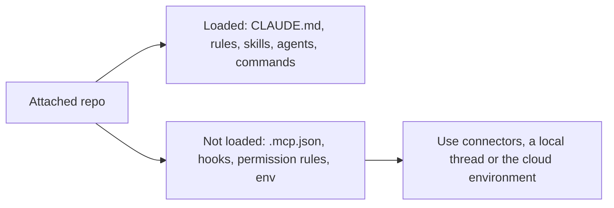

# Cloud threads: what loads and what limits

Part of the [Projects setup](README.md). Linked from [instructions.md](instructions.md).

## What a cloud thread loads

A thread clones each attached repo. It does not read everything in `.claude/`.

| In the repo | Cloud thread | If you need it |
|---|---|---|
| `CLAUDE.md`, and the `.claude/` folder's own CLAUDE.md and rules | Loaded. Path-specific rules wait | |
| Skills, agents, commands | Loaded | A dot-named repo skips them: run the thread as a Remote Control session |
| `.mcp.json` servers | Not loaded | Use your account's connectors |
| Hooks and permission rules in `.claude/settings.json` | Not run | Use a local thread |
| `env` in `.claude/settings.json` | Not applied | Set it in the cloud environment |

## Limits and cost

Projects need a Pro, Max or Ultra plan, not Team or Enterprise. The thread limit, the cache, models, pull request watching, usage limits and each spend guard are kept in one place: Compute Crafter's [Claude Code Projects spend guards](https://github.com/SoulCraft-Org/compute-crafter/blob/main/docs/claude-code-projects-spend.md). Read the figures there, not a copy here.
