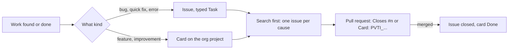

# Tracking: issues and project cards

A Claude Code Project merges many pull requests. This rule records each one, so no bug and no feature goes unrecorded.

| Work | Record | State when done | Template |
|---|---|---|---|
| Bug, quick fix or error | Issue | Closed as completed by the pull request | `.github/ISSUE_TEMPLATE/fix.yml` or `bug.yml` |
| Feature or improvement | Draft card on the org project. A thread that cannot reach the board files an issue typed Feature with the `enhancement` label. The board's auto-add cards it | Status Done | The org project's card fields |
| Idea with no plan | Card, status Todo | Stays on the board | The same card |

## Rules

| Rule | Detail |
|---|---|
| Scope | Every repo a thread touches: project repos, a user's own repos, the org's repos and any public repo it sends a pull request to |
| To do and done | Record both. A fix made inside a pull request still gets an issue, so the Issues tab shows it |
| Search first | Search open and closed issues and the board before filing. Extend a match, never duplicate it |
| One cause | One issue per cause, one card per outcome |
| Area label | Every issue carries one area label from `area_labels` in the repo's `config/quality/targets/github.json`, next to `enhancement` or its type. The Issues tab reads it (`issues.area_labeled`, goal 100%) |
| Link | The pull request has `Closes #n`, or `Card: PVTI_...` for a draft card with no issue number, on a line of its own. Any position passes, so attribution lines may come first |
| Public repos | File only what the pull request needs. Never put a private name, path or key in a public issue |
| Missed metrics | `quality/sync-issues.mjs` files them. Do not file them by hand |

## Backfill

Run once when a repo joins a project, then for each merged pull request.

| Step | Do |
|---|---|
| 1 | List pull requests merged in the last 30 days |
| 2 | Keep those whose body has no `Closes`, `Fixes`, `Resolves` or `Card:` line |
| 3 | For a bug, quick fix or error, open an issue with the fix table and close it as completed, linking the pull request |
| 4 | For a feature or improvement, add a card with status Done and link the pull request |

## Sources

Read 2026-11-25: [claude-projects](https://code.claude.com/docs/en/claude-projects) for threads that each open a branch and draft pull request. [Linking a pull request to an issue](https://docs.github.com/en/issues/tracking-your-work-with-issues/using-issues/linking-a-pull-request-to-an-issue) for `Closes #n`.
