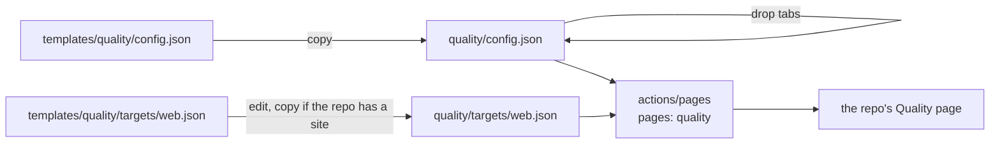

# Quality starter

[config.json](config.json) turns on all 13 tabs of the Quality, Speed and Consumption page. Copy it to `<repo>/quality/config.json`, then drop the tabs your repo cannot use. Keys: [quality/CONFIG.md](../../quality/CONFIG.md).

## Each tab and what it needs

A metric whose token is missing reads not measured, never 0, so a tab you keep is safe.

| Tab | Measures | Needs | Drop it when |
| --- | --- | --- | --- |
| `code` | size, complexity, copies, dead code, test coverage, Code Quality | `github-admin`, `cloudflare` | never |
| `documentation` | dead paths, links, visuals, reading time | none | never |
| `issues` | bugs and quick fixes, forms, types, labels, time to close | none | never |
| `pull-requests` | size, review at head, side-branch merges, wait after green | none | never |
| `discussions` | unanswered questions and their age | none | Discussions stays off |
| `actions` | CI speed, red time, runner cost, tests, hardened workflows | `github-admin` | never |
| `projects` | board flow, cards at a glance, cycle time | `project-scope` | no GitHub Project board |
| `security` | policy, threat model, alert age, paid features | `github-admin` | never |
| `dependabot` | alerts, malware, updates, dependencies and actions current | `github-admin`, `vulnerability-alerts` | never |
| `scanning` | code scanning, secret scanning, scan minutes | `github-admin` | never |
| `insights` | health files, leftover branches, failed minutes | `github-admin` | never |
| `settings` | rules with no bypass, outside access, unused secrets, settings that bill | `github-admin` | never |
| `pages` | deploys (DORA), design tokens, contrast, Core Web Vitals, axe, task clicks | `wrangler-login` | the repo serves no site |

| Needs | Set it by |
| --- | --- |
| `github-admin` | `admin-read-token` on `actions/pages`, or a `--local` run |
| `vulnerability-alerts` | `permissions: vulnerability-alerts: read` on the job |
| `project-scope` | that token with Projects read, or `gh auth refresh -s project` and a `--local` run |
| `wrangler-login` | a Wrangler login, or `platform: "pages"` for GitHub Pages |
| `cloudflare` | a `cf` login, `--local` runs only |

## The pages tab

| It reads | Which is |
| --- | --- |
| `params.origin` | the production URL |
| or `params.site_dir` | a built site folder |

Edit [targets/web.json](targets/web.json), then copy it to `<repo>/quality/targets/web.json`. Its `comment` says what each entry sets.

## The Issues tab

| To reach its goal | Do |
| --- | --- |
| `issues.intake_ready` | Copy [bug.yml, fix.yml and config.yml](../open/.github/ISSUE_TEMPLATE). Each form sets its issue type |
| `issues.parked_open` | Keep work that is not a bug or a quick fix as a draft card on the board. `params.issue_types` lists the types an issue may have. Empty turns the check off |
| `issues.area_labeled`, `issues.stray_labels` | Name your area labels in `params.area_labels`, and archive each label nothing uses |

| Renamed on 2026-11-10 | Now |
| --- | --- |
| `issues.templates_present` | `issues.intake_ready` |
| `issues.oldest_open_bug_days` | `issues.oldest_open_days` |

An override naming an old id stops the build (exit 2).

## From v6 to v7

v7.0.0 maps the tabs onto GitHub's. Every id stays. A removed tab id stops (exit 2) and names its new home. Each id: [quality/ledger/tab-remap.json](../../quality/ledger/tab-remap.json).

## Next

| Step | File |
| --- | --- |
| The Process page | [templates/process](../process/README.md) |
| CI, the pages workflow and Dependabot | [templates/ci](../ci/README.md) |
