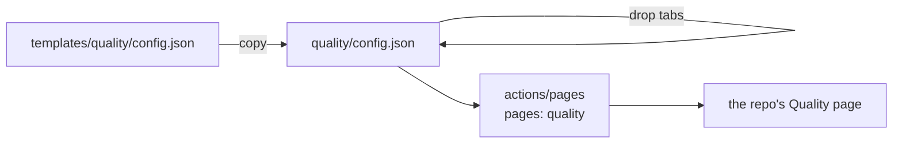

# Quality starter

[config.json](config.json) turns on all 14 tabs of the Quality, Speed and Consumption page. Copy it to `<repo>/quality/config.json`, then drop the tabs your repo has no use for. Keys: [quality/CONFIG.md](../../quality/CONFIG.md).

## What each tab measures

| Tab | Measures |
| --- | --- |
| `code` | size, complexity, copies, dead code |
| `documentation` | dead paths, links, visuals, reading time |
| `issues` | bugs and quick fixes, forms, types, labels, time to close |
| `projects` | board flow, cards at a glance, cycle time |
| `pull-requests` | size, review at head, side-branch merges, wait after green |
| `actions` | CI speed, red time, runner cost, locked workflows |
| `tests` | skips, pass rate, test minutes |
| `security` (Security and quality) | pins, scanning, threat model, alerts |
| `insights` | health files, leftover branches, failed minutes |
| `settings` | rules with no bypass, outside access, unused secrets, rules that wait for a person, settings that bill |
| `design` | tokens, contrast, Core Web Vitals |
| `usability` | axe, tap targets, task clicks |
| `deploy` | lead time, failures, restore (DORA) |
| `tools` | dependencies and actions current |

## Which tabs to drop

✓ keeps the tab, ✗ drops it.

| Tab | Library | Web app | Docs site | Data or ML |
| --- | :-: | :-: | :-: | :-: |
| `code`, `documentation`, `issues`, `pull-requests`, `actions`, `tests`, `security`, `insights`, `settings`, `tools` | ✓ | ✓ | ✓ | ✓ |
| `design`, `usability` (score a site the repo serves) | ✗ | ✓ | ✓ | ✗ |
| `deploy` (reads a Cloudflare Worker with Wrangler) | ✗ | ✓ | ✗ unless on Workers | ✗ |
| `projects` | ✓ with a GitHub Project board, else ✗ | same | same | same |
| The six Claude tabs | moved to `Colorado-Startups/claudius`; load them through the `packs` key | same | same | same |
| `credits` (free allowances the repo draws on) | moved to `SoulCraft-Org/compute-crafter`; load it through the `packs` key | same | same | same |

A web tab needs `params.origin` (the production URL) or `params.site_dir` (a built site folder) in `<repo>/quality/targets/`. A dropped tab is not collected, shown or scored.

A repo with its own `tabs` list adds `settings`: the five `settings.*` metrics moved there from `security`.

## The Issues tab

| To reach its goal | Do |
| --- | --- |
| `issues.intake_ready` | Copy [bug.yml, fix.yml and config.yml](../../.github/ISSUE_TEMPLATE); each form sets its issue type |
| `issues.parked_open` | Keep work that is not a bug or a quick fix as a draft card on the board. `params.issue_types` lists the types an issue may have; empty turns the check off |
| `issues.area_labeled`, `issues.stray_labels` | Name your area labels in `params.area_labels`, and archive each label nothing uses |

Two ids changed on 2026-11-10: `issues.templates_present` became `issues.intake_ready`, and `issues.oldest_open_bug_days` became `issues.oldest_open_days`. An override that still names an old id stops the build (exit 2).

## Next

| Step | File |
| --- | --- |
| The Process page | [templates/process](../process/README.md) |
| CI, the pages workflow and Dependabot | [templates/ci](../ci/README.md) |
