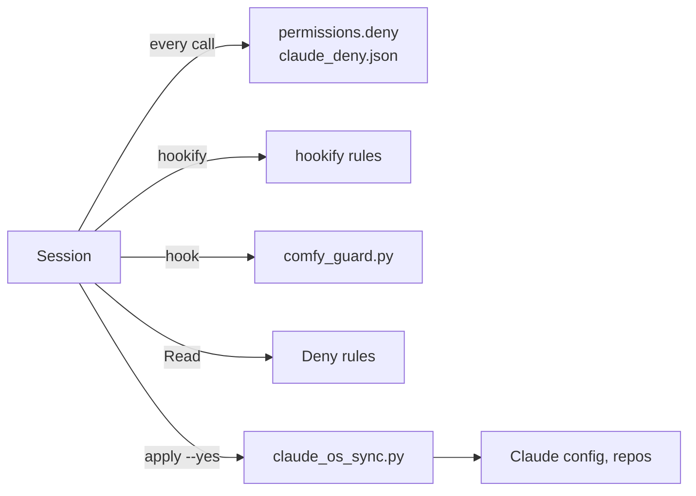

# Threat model: guards and sync

What runs on a session's machine. [THREAT-MODEL.md](../THREAT-MODEL.md) dates each read and holds the CI rows.

| Element | Threat | STRIDE | Control | Gap |
|---|---|---|---|---|
| [claude_deny.json](claude_deny.json) | Missed one-way door runs | Elevation | Claude Code's own `permissions.deny`, in every mode. Each rule's block and allow examples run in CI | A program by path, inside `sh -c`, or in a form no rule names (code.claude.com/docs/en/permissions, read 2026-11-14). 9 retired guard rules have no deny form (its `uncovered` list) |
| [claude_deny.json](claude_deny.json) | The rules are not installed | Tampering | `claude_deny.py --check ~/.claude/settings.json`, a merge condition | Only when run |
| [claude_deny.json](claude_deny.json) | Command prints a key | Disclosure | Read rules on credential paths. Bash rules on env dumps, key variables and token printers | Scripts opening files; the sandbox is the boundary |
| [claude_deny.json](claude_deny.json) | Command runs as root | Elevation | `sudo`, `su` and an admin dialog with a password deny | The dialog's prompt text goes unchecked |
| [block-rm-home](../.claude/hookify.block-rm-home.local.md) | The home folder is deleted | Tampering | Deny rules for the exact forms and Claude Code's critical-path prompt. This hookify rule covers wrapped ones | It loads only in sessions run from `~` or Git Crafter. A script that deletes: the 2026-11-04 case ([rules/gates.md](../rules/gates.md)) |
| [block-rm-home](../.claude/hookify.block-rm-home.local.md) | Huge command stalls the hook | Denial | `hookify_check.py` times each pattern on 140 KB decoys, under 1 s | Hookify allows on a timeout |
| [no-banned-dash](../.claude/hookify.no-banned-dash.local.md) | Banned prose lands | Tampering | Blocks an em dash or spaced en dash in `.md`, `.mdx` or `.txt`. Checked against `voice_lint.py` | Same loading; text written through Bash |
| One-way deletes | Session deletes the wrong repo, Worker, database, ruleset or branch protection | Tampering | [rules/delegation.md](../rules/delegation.md): read the target first. Put the reason on the command | No second person, and nothing checks the reason. The session decides (the owner, 2026-11-10) |
| [Deny rules](../.claude/settings.json) | Claude reads a credential | Disclosure | `Read(...)` denies per `params.credential_patterns` | `grep -r` and scripts |
| [claude_os_sync.py](claude_os_sync.py) | Write escapes the repo | Tampering | `realpath` check; only [manifest.json](../manifest.json) and overlay paths | A trusted manifest |
| [claude_os_sync.py](claude_os_sync.py) | Work in progress is overwritten | Tampering | Refuses a dirty target checkout or edited copy | Only prints a wrong branch |
| [claude_os_sync.py](claude_os_sync.py) | Unreviewed rules reach `~/.claude` | Elevation | Apply writes only from clean `main` at `origin/main`, overlays too; no outside `--manifest` | A failed fetch stops apply |
| [comfy_guard.py](comfy_guard.py) | Open-weight runs drain plan credits | Denial | Denies unless `usage-guard check comfy-cloud` says go; fails closed | A run in flight; a rewritten `usage-guard`; unwired accounts |
| [comfy_guard.py](comfy_guard.py) | Session confirms paid API nodes unasked | Elevation | A `confirm` or `partner_generate` item asks the owner; no-prompt modes deny | Unwired accounts |

Report findings: [SECURITY.md](../SECURITY.md).
