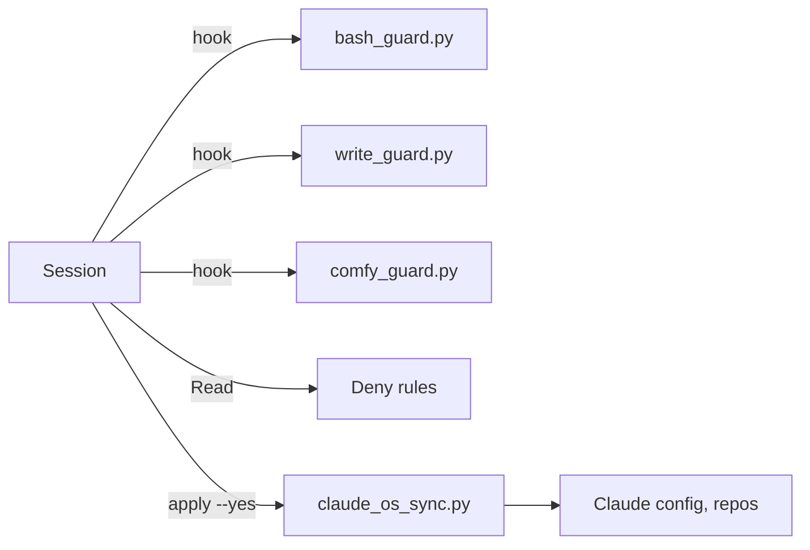

# Threat model: guards and sync

What runs on a session's machine. [THREAT-MODEL.md](../THREAT-MODEL.md) dates each read and holds the CI rows.

| Element | Threat | STRIDE | Control | Gap |
|---|---|---|---|---|
| [bash_guard.py](bash_guard.py) | Missed one-way door runs | Elevation | CI-tested rules; a door before an unparseable line blocks | Bypass families (#102, #85) |
| [bash_guard.py](bash_guard.py) | Huge command stalls the hook | Denial | The 148 KB decoy runs under 2 s (CI, 2026-11-10) | Larger inputs unmeasured |
| [bash_guard.py](bash_guard.py) | Hook is unwired or incomplete | Tampering | `--status` runs a canary | Only when called; a missing module fails open |
| [bash_guard.py](bash_guard.py) | Command prints a key | Disclosure | Credential and env rules | Scripts opening files |
| [bash_guard.py](bash_guard.py) | Session loosens a repo's rulesets | Elevation | Deletes and org ruleset writes block | Repo updates allowed; missed `gh api` forms |
| [bash_guard.py](bash_guard.py) | Session deletes the wrong repo, Worker, database or ruleset | Tampering | A one-way delete blocks unless the command carries `ONE_WAY_REASON`. The rule says read the target first | No second person. The session decides (the owner, 2026-11-10) |
| [bash_guard.py](bash_guard.py) | Command runs as root | Elevation | `sudo` blocks; the admin dialog passes, naming the change | The owner reads it |
| [write_guard.py](write_guard.py) | Banned prose lands | Tampering | `voice_lint.py` FAIL checks; bypass mode swaps dash for comma | Unwired by default |
| [Deny rules](../.claude/settings.json) | Claude reads a credential | Disclosure | `Read(...)` denies per `params.credential_patterns` | `grep -r` and scripts |
| [claude_os_sync.py](claude_os_sync.py) | Write escapes the repo | Tampering | `realpath` check; only [manifest.json](../manifest.json) and overlay paths | A trusted manifest |
| [claude_os_sync.py](claude_os_sync.py) | Work in progress is overwritten | Tampering | Refuses a dirty target checkout or edited copy | Only prints a wrong branch |
| [claude_os_sync.py](claude_os_sync.py) | Unreviewed rules reach `~/.claude` | Elevation | Apply writes only from clean `main` at `origin/main`, overlays too; no outside `--manifest` | A failed fetch stops apply |
| [comfy_guard.py](comfy_guard.py) | Open-weight runs drain plan credits | Denial | Denies unless `usage-guard check comfy-cloud` says go; fails closed | A run in flight; a rewritten `usage-guard`; unwired accounts |
| [comfy_guard.py](comfy_guard.py) | Session confirms paid API nodes unasked | Elevation | A `confirm` or `partner_generate` item asks the owner; no-prompt modes deny | Unwired accounts |

Report findings: [SECURITY.md](../SECURITY.md).
